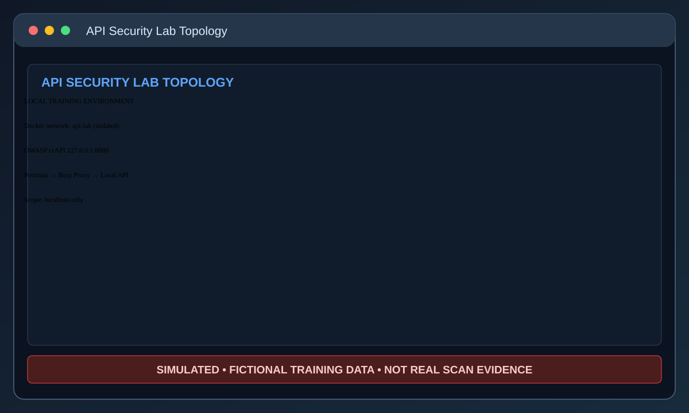
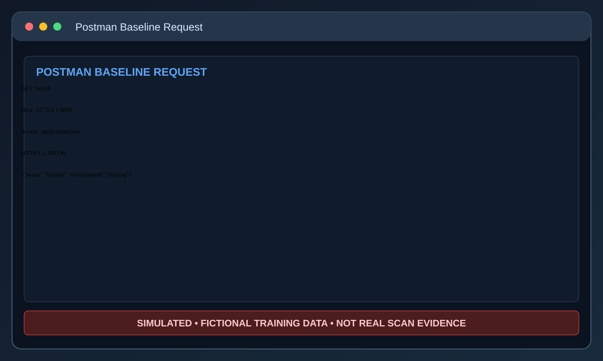
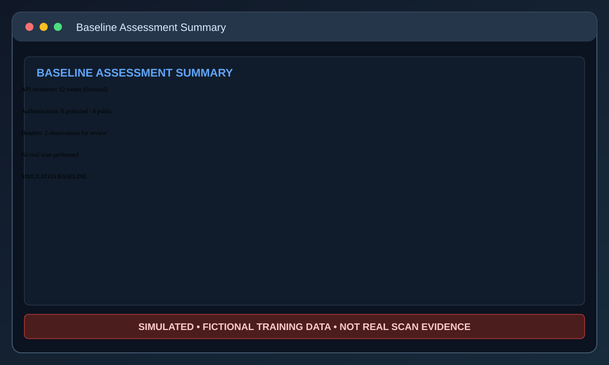

# 01. API Security Testing Lab Setup

**Level:** Beginner  
**Focus:** Build an isolated API security testing environment  
**Tools:** Docker, OWASP crAPI, Postman, Burp Suite Community, curl, jq

## Objective
Create a repeatable local API security testing environment and establish a baseline.

## Scope and safety
This walkthrough is for an isolated, intentionally vulnerable local training API or a system you own and are explicitly authorized to assess. Use synthetic data and disposable accounts. Do not test public or production APIs without written permission. Screenshots are simulated fictional training visuals, not evidence from a real assessment.

## Lab preparation
Deploy OWASP crAPI or another intentionally vulnerable API locally. Bind ports to localhost, keep the lab off public interfaces, and use disposable test accounts.

## Walkthrough
1. Create folders for notes, requests, evidence, and reports.
2. Start the intentionally vulnerable API using its official local deployment instructions; confirm its listening interface.
3. Review API documentation and record base paths, methods, parameters, content types, and authentication requirements.
4. Import the OpenAPI definition into Postman or create a small collection manually.
5. Proxy a harmless request through Burp Suite and inspect method, path, headers, body, and response.
6. Repeat the request with curl and jq; record status codes, response sizes, and security headers.
7. Save a baseline and note which endpoints require authentication.

## Example commands
Run only against your local lab; adjust port and paths to match your environment.
```bash
docker ps
ss -lnt
curl -i http://127.0.0.1:8888/
curl -s http://127.0.0.1:8888/health | jq .
```

## What to look for
Baseline observations may include undocumented routes, verbose banners, missing headers, detailed errors, or routes responding without authentication. Validate each observation before calling it a vulnerability.

## Remediation guidance
Isolate the lab, remove debug routes, minimize banners and error detail, document public endpoints, and enforce authentication and authorization per route.

## Validation
Repeat the baseline after changes. Confirm protected routes require authentication and responses disclose no stack traces or secrets.

## Simulated walkthrough screenshots
The following visuals illustrate the workflow and fictional training output. They are not genuine tool captures or scan evidence.
### Lab / request setup



### Testing workflow



### Findings and remediation



## Evidence and reporting
Record approved scope, test date, lab version, account role, endpoint and method, sanitized request/response, expected versus observed behavior, impact, severity rationale, remediation, retest result, and limitations. Never publish real client identifiers, tokens, credentials, or personal data.

## Completion checklist
- [ ] Lab is isolated and uses synthetic data.
- [ ] Endpoints and test roles are documented.
- [ ] Requests and responses are sanitized.
- [ ] Findings are validated rather than inferred from tool alerts.
- [ ] Remediation and regression checks are documented.
- [ ] No real secrets or personal data are committed.

---
*Training material for authorized API security testing. Example results and screenshot content are fictional.*
