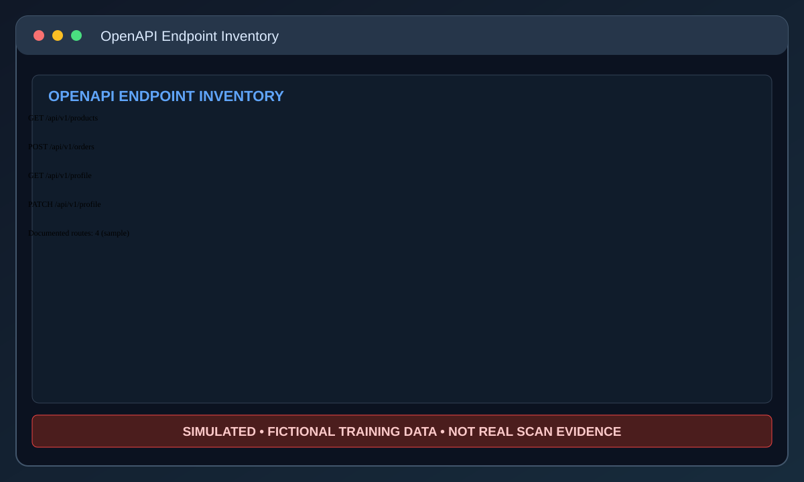
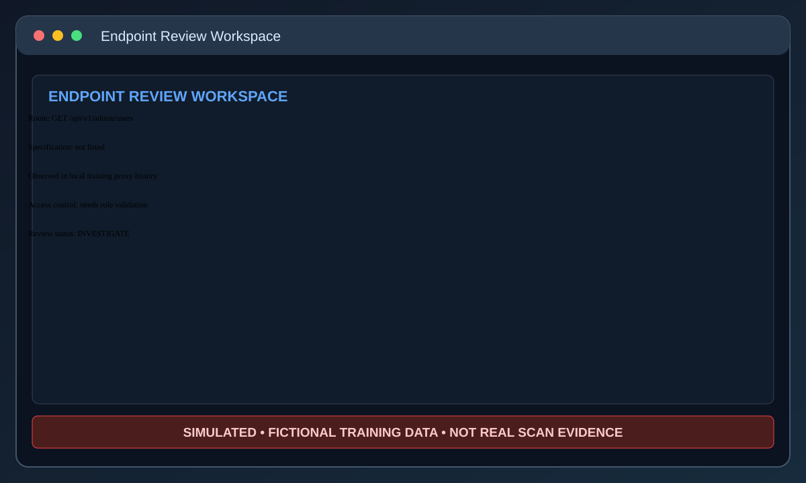
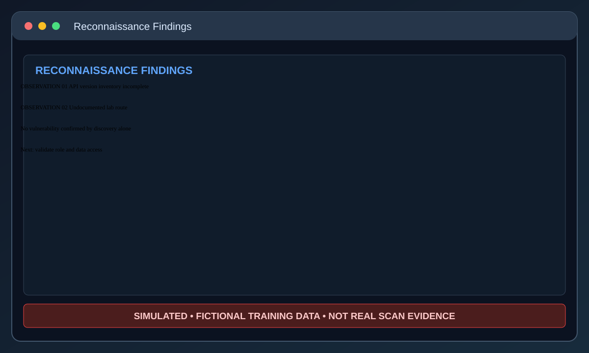

# 02. API Reconnaissance and Endpoint Discovery

**Level:** Beginner  
**Focus:** Map an API's documented and observed attack surface  
**Tools:** OpenAPI/Swagger, Postman, Burp Suite, curl, jq

## Objective
Build an endpoint inventory and identify undocumented or inconsistent API routes.

## Scope and safety
This walkthrough is for an isolated, intentionally vulnerable local training API or a system you own and are explicitly authorized to assess. Use synthetic data and disposable accounts. Do not test public or production APIs without written permission. Screenshots are simulated fictional training visuals, not evidence from a real assessment.

## Lab preparation
Use the local API from Project 01 or an intentionally vulnerable training application. Keep an OpenAPI copy and a low-privilege test account.

## Walkthrough
1. Collect the OpenAPI specification, Swagger UI routes, API version information, and developer documentation.
2. Extract paths, methods, parameters, request and response schemas, and declared authentication schemes.
3. Compare documented routes with routes observed in browser or proxy history.
4. Check common API prefixes and version patterns only against the local lab; record responses.
5. For each endpoint, note authentication requirements and expected role or object.
6. Identify undocumented endpoints, deprecated versions, inconsistent methods, and excessive list responses.
7. Create an endpoint matrix with documented, observed, authenticated, role-restricted, and unverified status.

## Example commands
Run only against your local lab; adjust port and paths to match your environment.
```bash
jq -r '.paths | to_entries[] | .key as $p | .value | keys[] | "\(. | ascii_upcase) \($p)"' openapi.json
curl -i http://127.0.0.1:8888/api/v1/status
```

## What to look for
Reconnaissance leads include undocumented administrative routes, old API versions, inconsistent authentication, and excessive object fields. Endpoint existence alone is not a vulnerability.

## Remediation guidance
Maintain an API inventory, remove obsolete routes, protect administrative functionality, apply consistent authorization, and keep documentation aligned with deployment.

## Validation
Re-run the inventory. Confirm retired routes are unavailable, active routes are documented, and role requirements match the access matrix.

## Simulated walkthrough screenshots
The following visuals illustrate the workflow and fictional training output. They are not genuine tool captures or scan evidence.
### Lab / request setup



### Testing workflow



### Findings and remediation



## Evidence and reporting
Record approved scope, test date, lab version, account role, endpoint and method, sanitized request/response, expected versus observed behavior, impact, severity rationale, remediation, retest result, and limitations. Never publish real client identifiers, tokens, credentials, or personal data.

## Completion checklist
- [ ] Lab is isolated and uses synthetic data.
- [ ] Endpoints and test roles are documented.
- [ ] Requests and responses are sanitized.
- [ ] Findings are validated rather than inferred from tool alerts.
- [ ] Remediation and regression checks are documented.
- [ ] No real secrets or personal data are committed.

---
*Training material for authorized API security testing. Example results and screenshot content are fictional.*
