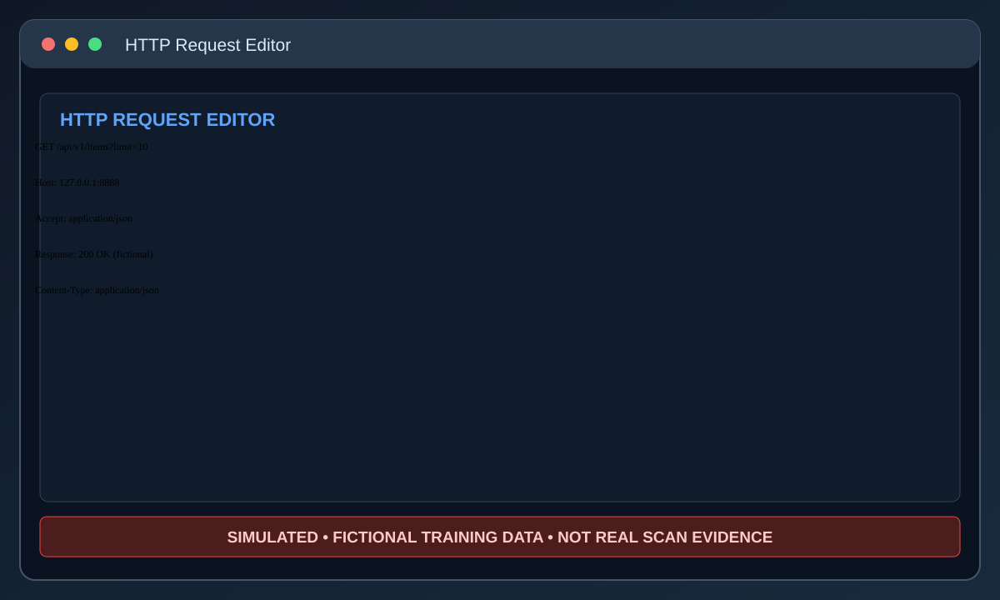
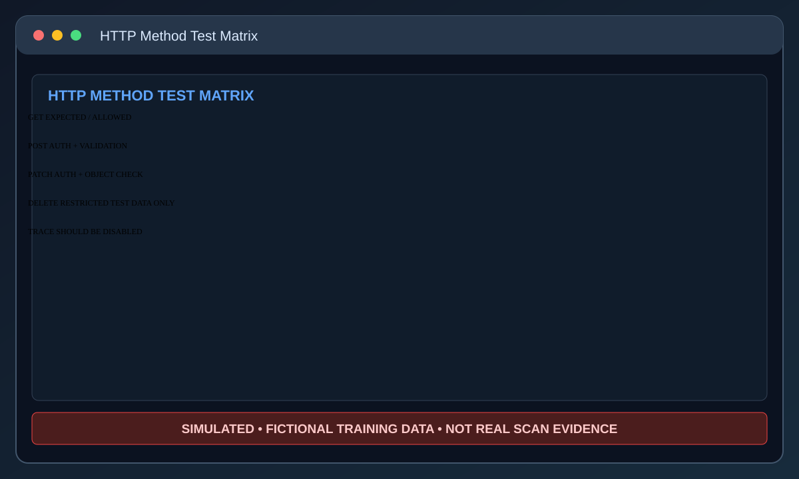
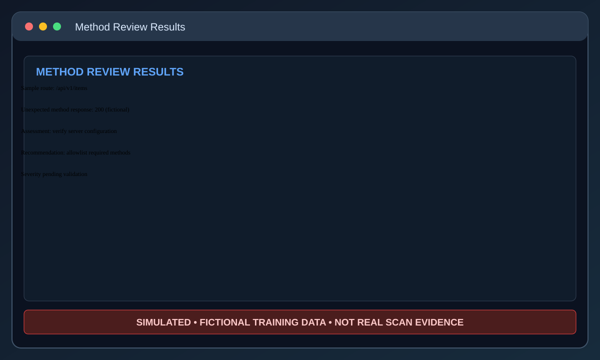

# 03. HTTP Methods and API Request Analysis

**Level:** Beginner  
**Focus:** Review HTTP methods, content negotiation, and request handling  
**Tools:** curl, Postman, Burp Suite, jq

## Objective
Identify unsafe method exposure, inconsistent validation, and unexpected state changes.

## Scope and safety
This walkthrough is for an isolated, intentionally vulnerable local training API or a system you own and are explicitly authorized to assess. Use synthetic data and disposable accounts. Do not test public or production APIs without written permission. Screenshots are simulated fictional training visuals, not evidence from a real assessment.

## Lab preparation
Use a local training API with disposable records. Create a low-privilege account and harmless test object. Never test destructive methods against real data.

## Walkthrough
1. Capture a normal GET request and document its path, query parameters, headers, and response schema.
2. Send an unsupported method and record whether the server returns 405, 404, or another response.
3. Review POST, PUT, PATCH, and DELETE using disposable lab records only.
4. Compare Content-Type and Accept handling; verify unsupported media types are rejected predictably.
5. Check whether X-HTTP-Method-Override is enabled and whether it is actually required.
6. Verify state-changing methods require authentication, authorization, and appropriate CSRF protection when browser cookies are used.
7. Compare responses with the API contract and document unexpected behavior.

## Example commands
Run only against your local lab; adjust port and paths to match your environment.
```bash
curl -i -X GET http://127.0.0.1:8888/api/v1/items
curl -i -X OPTIONS http://127.0.0.1:8888/api/v1/items
curl -i -X TRACE http://127.0.0.1:8888/api/v1/items
curl -i -X POST http://127.0.0.1:8888/api/v1/items -H 'Content-Type: text/plain' --data 'training-marker'
```

## What to look for
Potential issues include unnecessary methods, inconsistent authorization between read and mutation methods, permissive content-type handling, and method-override behavior that bypasses upstream assumptions.

## Remediation guidance
Allow only required methods, enforce authorization on every method and object, validate content types and schemas, disable unnecessary method overrides, and apply anti-CSRF controls where relevant.

## Validation
Repeat checks with the same test account. Confirm unsupported methods are rejected and permitted mutations are authorized and validated.

## Simulated walkthrough screenshots
The following visuals illustrate the workflow and fictional training output. They are not genuine tool captures or scan evidence.
### Lab / request setup



### Testing workflow



### Findings and remediation



## Evidence and reporting
Record approved scope, test date, lab version, account role, endpoint and method, sanitized request/response, expected versus observed behavior, impact, severity rationale, remediation, retest result, and limitations. Never publish real client identifiers, tokens, credentials, or personal data.

## Completion checklist
- [ ] Lab is isolated and uses synthetic data.
- [ ] Endpoints and test roles are documented.
- [ ] Requests and responses are sanitized.
- [ ] Findings are validated rather than inferred from tool alerts.
- [ ] Remediation and regression checks are documented.
- [ ] No real secrets or personal data are committed.

---
*Training material for authorized API security testing. Example results and screenshot content are fictional.*
