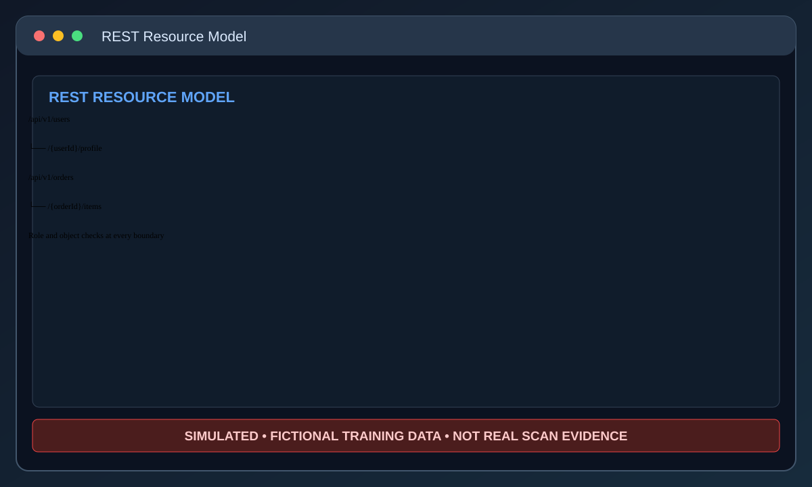
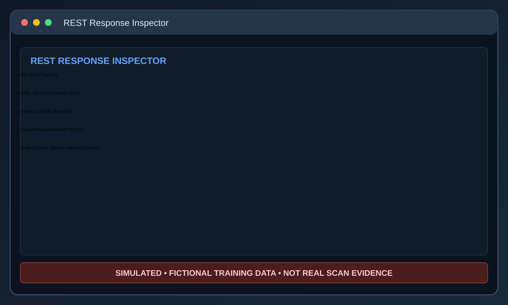
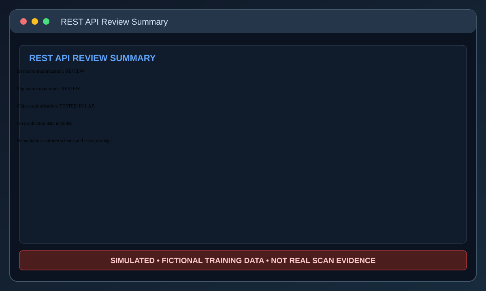

# 04. REST API Security Fundamentals

**Level:** Beginner  
**Focus:** Review REST API design, data exposure, and access controls  
**Tools:** Postman, curl, jq, OpenAPI, Burp Suite

## Objective
Assess least privilege, predictable resource handling, schema validation, and minimal data exposure.

## Scope and safety
This walkthrough is for an isolated, intentionally vulnerable local training API or a system you own and are explicitly authorized to assess. Use synthetic data and disposable accounts. Do not test public or production APIs without written permission. Screenshots are simulated fictional training visuals, not evidence from a real assessment.

## Lab preparation
Deploy a local REST training API with two test users and separate records. Use synthetic personal data only; document public and protected endpoints.

## Walkthrough
1. Map resources and relationships from the API specification, including collection, item, and nested-resource routes.
2. Review authentication and authorization for every operation, not just each route family.
3. Compare fields returned to different roles; ensure sensitive properties are omitted unless needed.
4. Inspect pagination, filtering, sorting, and expansion for excessive data exposure and unbounded responses.
5. Review input schemas for type, length, range, and allowed-value constraints.
6. Check error handling, status codes, cache directives, and versioning behavior.
7. Build a role-to-resource matrix and compare expected with observed access.

## Example commands
Run only against your local lab; adjust port and paths to match your environment.
```bash
curl -s 'http://127.0.0.1:8888/api/v1/items?limit=10' | jq .
curl -sSI http://127.0.0.1:8888/api/v1/profile
curl -s http://127.0.0.1:8888/api/v1/profile -o profile-response.json
```

## What to look for
REST weaknesses often include excessive response fields, inconsistent role checks, unbounded collections, weak input constraints, and caching of sensitive responses.

## Remediation guidance
Apply least privilege at route and object level, return only necessary fields, enforce pagination limits, validate schemas, and use safe cache directives for sensitive responses.

## Validation
Retest with multiple roles and synthetic records. Compare response schemas, enforce maximum page sizes, and verify sensitive responses are not stored by shared caches.

## Simulated walkthrough screenshots
The following visuals illustrate the workflow and fictional training output. They are not genuine tool captures or scan evidence.
### Lab / request setup



### Testing workflow



### Findings and remediation



## Evidence and reporting
Record approved scope, test date, lab version, account role, endpoint and method, sanitized request/response, expected versus observed behavior, impact, severity rationale, remediation, retest result, and limitations. Never publish real client identifiers, tokens, credentials, or personal data.

## Completion checklist
- [ ] Lab is isolated and uses synthetic data.
- [ ] Endpoints and test roles are documented.
- [ ] Requests and responses are sanitized.
- [ ] Findings are validated rather than inferred from tool alerts.
- [ ] Remediation and regression checks are documented.
- [ ] No real secrets or personal data are committed.

---
*Training material for authorized API security testing. Example results and screenshot content are fictional.*
