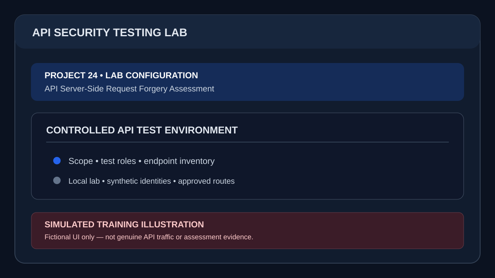
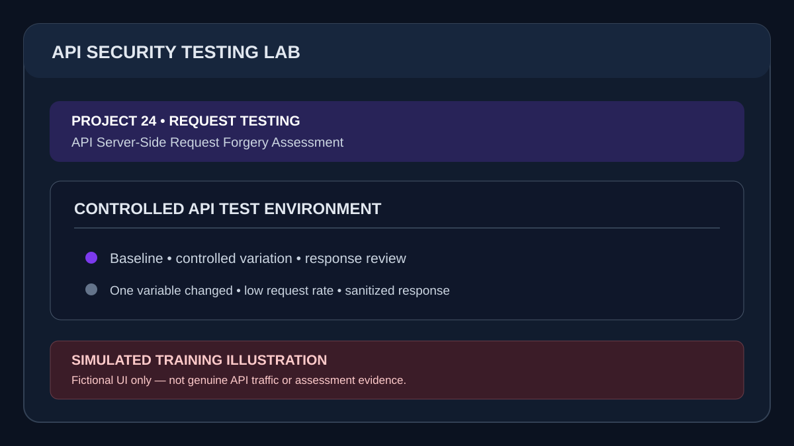

# Project 24: API Server-Side Request Forgery Assessment

> **Authorized training lab only.** Use a local intentionally vulnerable API or a service covered by written permission. Identities, records, tokens, and findings are fictional. Never publish credentials, personal data, or production traffic.

## 1. Objective
Assess outbound request controls using mock endpoints. Demonstrate a repeatable method to identify, validate, document, and remediate API security weaknesses.

## 2. Scenario and scope
A fictional application exposes JSON endpoints to web, mobile, and service clients. Use an isolated lab and synthetic accounts.
- **In scope:** documented lab host, approved endpoints/methods, test accounts, synthetic records, and API version.
- **Out of scope:** third-party APIs, production data, denial-of-service, destructive changes, credential stuffing, and out-of-scope testing.
- Record authorization, owner, time window, source IP, rate limits, exclusions, and stop conditions.

## 3. Prerequisites
- Kali Linux or another security workstation; local API lab such as OWASP crAPI or Juice Shop.
- Postman/Insomnia, curl, Burp Suite or OWASP ZAP, and OpenAPI documentation where available.
- Distinct least-privilege test roles and a sanitized evidence log.

## 4. Methodology
1. Confirm exact scope, API version, allowed endpoints, methods, test identities, and request rate.
2. Inventory routes, HTTP methods, parameters, content types, and authentication requirements.
3. Establish normal request/response baselines; record status, schema, headers, and expected behavior.
4. Build a test matrix for the control area: Assess outbound request controls using mock endpoints.
5. Change one variable at a time using synthetic values. Compare two controlled users/records for authorization tests. Avoid destructive payloads and high-volume traffic.
6. Repeat observations, validate server-side behavior, and rule out client-only effects or test artifacts.
7. Assess confidentiality, integrity, availability, privilege, tenant boundaries, and realistic business impact.
8. Recommend server-side fixes, repeat the safe test, and verify legitimate functionality remains available.

## 5. Tools and example requests
Set a lab-only base URL:
```bash
export API_BASE="http://127.0.0.1:PORT"
curl -i "$API_BASE/health"
curl -i -H "Accept: application/json" "$API_BASE/api/v1/status"
```
Authenticated lab request (store the token locally; never commit it):
```bash
curl -i -H "Authorization: Bearer $LAB_TOKEN" \
  -H "Accept: application/json" "$API_BASE/api/v1/profile"
```
Use documented routes, synthetic inputs, conservative scanner settings, and only the authorized lab.

## 6. Expected results
Produce an endpoint inventory, baseline exchange, test cases, reproducible observations, and a finding register. Example findings and responses must be synthetic; do not portray mock output as actual execution.

## 7. Risk analysis
Consider confidentiality, integrity, availability, tenant isolation, privilege boundaries, prerequisites, exposure, and business impact. Distinguish confirmed vulnerabilities from hardening advice and hypotheses. Use a documented severity method such as CVSS with business context.

## 8. Remediation
Prefer server-side enforcement: authenticate and authorize every request and object, validate strict schemas, parameterize database operations, minimize response properties, protect tokens, configure TLS/CORS deliberately, and bound resource use. Tie each fix to a finding and owner.

## 9. Validation and closure
- Repeat the exact safe test with the same synthetic identities.
- Confirm unauthorized requests fail server-side and legitimate requests still succeed.
- Verify protected properties and internal errors are not exposed.
- Check controls consistently across versions and gateway paths.
- Record sanitized before/after evidence, tool versions, timestamps, and limitations.
- Mark **fixed**, **mitigated**, **accepted**, or **not reproducible** with rationale.

## 10. Evidence and reporting
Retain authorization, endpoint inventory, sanitized HTTP exchanges, test matrix, relevant configuration, severity rationale, remediation owner, and retest result. Redact cookies, bearer tokens, API keys, identifiers, and personal data. Report scope, methodology, findings, impact, priorities, and residual risk.

## 11. Standards and references
Map applicable findings to the current [OWASP API Security Top 10](https://owasp.org/API-Security/), [OWASP WSTG](https://owasp.org/www-project-web-security-testing-guide/), [OWASP ASVS](https://owasp.org/www-project-application-security-verification-standard/), and relevant [NIST SP 800-53](https://csrc.nist.gov/pubs/sp/800/53/r5/upd1/final) controls. Mapping is not certification.

## 12. Training illustrations
These are **simulated training illustrations**, not genuine screenshots, API traffic, or proof of testing.





## 13. Completion checklist
- [ ] Authorization and scope recorded
- [ ] Endpoint inventory and baseline captured
- [ ] Safe lab test cases executed
- [ ] Findings reproduced and impact validated
- [ ] Server-side remediation documented
- [ ] Retest and residual risk recorded
- [ ] Evidence sanitized before publication

---
**Portfolio note:** Educational template; adapt tests and severity to documented API behavior, current OWASP guidance, and approved rules of engagement.
